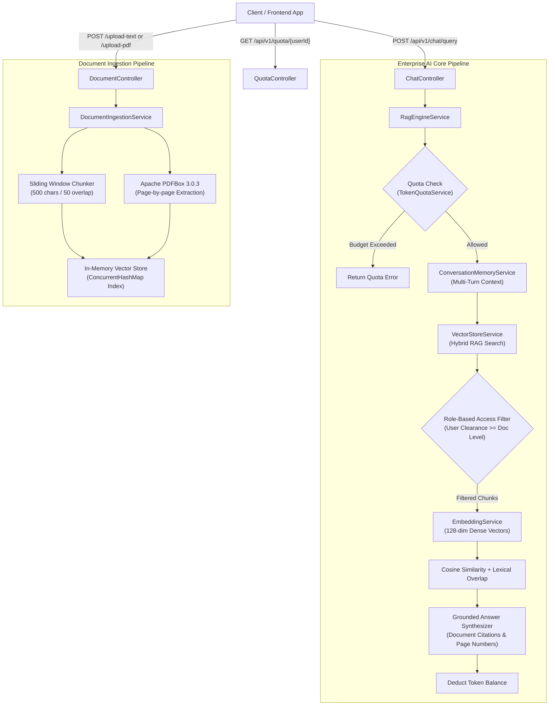

# Enterprise Knowledge Assistant with RAG, Vector Store, and Role-Based Access Control

An enterprise-grade Retrieval-Augmented Generation (RAG) backend engine built with Java 21 and Spring Boot. It provides dense vector embeddings, hybrid semantic-lexical search, tiered role-based access control (RBAC), multi-format document ingestion (Text and PDF), daily user token quota governance, and multi-turn session conversation memory.

---

## Architecture Overview



---

## Key Features

1. **Java 21 Modern Design:**
   - 100% boilerplate-free using Java 21 `record` types for all entities, models, and DTOs.
   - Immutable data structures preventing side-effects across asynchronous workflows.

2. **Hybrid RAG Search Engine:**
   - 128-dimensional dense vector embeddings generated with L2 normalization.
   - Hybrid Scoring Fusion: 50% dense cosine similarity + 50% sparse lexical token overlap with stopword filtering.
   - Low-latency, sub-millisecond in-memory vector lookup using concurrent data structures.

3. **Tiered Role-Based Access Control (RBAC):**
   - Five access clearance tiers: `PUBLIC (1) < ENGINEERING (2) < FINANCE (3) < HR (4) < ADMIN (5)`.
   - Pre-retrieval metadata filtering ensures confidential documents are never exposed to unauthorized roles.

4. **Multi-Turn Conversation Memory:**
   - Session-based conversation memory with a rolling context window.
   - Automatically enriches follow-up queries with previous conversation context.

5. **Multi-Format Ingestion:**
   - Plain text and enterprise PDF ingestion via Apache PDFBox 3.0.3.
   - Sliding-window chunking (500-character chunks with 50-character overlap) preserving cross-sentence context.

6. **Token Quota Governance:**
   - Tracks daily per-user token consumption against an administrative daily allowance (50,000 tokens default).
   - Rejects queries before retrieval when a user exceeds their daily allocation.

7. **Production Observability:**
   - Integrated Spring Boot Actuator with `/actuator/health` and `/actuator/metrics`.

---

## Clearance Hierarchy

| Access Tier | Clearance Rank | Description | Accessible Data |
|---|---|---|---|
| `PUBLIC` | 1 | General employees and external users | Public company policies, travel guidelines |
| `ENGINEERING` | 2 | Software and DevOps engineers | System runbooks, deployment guides, incident SOPs, Public data |
| `FINANCE` | 3 | Financial analysts and controllers | Compensation bands, salary structures, budget models, Public data |
| `HR` | 4 | Human Resources team members | Employee records, performance reviews, benefits, Public data |
| `ADMIN` | 5 | Enterprise system administrators | All enterprise documents across every department |

---

## API Endpoints and Curl Examples

### 1. Ingest Plain Text Document
```bash
curl -X POST http://localhost:8090/api/v1/documents/upload-text \
  -H "Content-Type: application/json" \
  -d '{
    "documentName": "Engineering_Runbook.txt",
    "content": "To trigger an emergency rollback of a failing service: kubectl rollout undo deployment/api-gateway -n production",
    "accessLevel": "ENGINEERING"
  }'
```

### 2. Ingest PDF Document
```bash
curl -X POST http://localhost:8090/api/v1/documents/upload-pdf \
  -F "file=@/path/to/Handbook.pdf" \
  -F "accessLevel=PUBLIC"
```

### 3. Query Assistant (RAG with Citations)
```bash
curl -X POST http://localhost:8090/api/v1/chat/query \
  -H "Content-Type: application/json" \
  -d '{
    "question": "What is the daily meal stipend for travel?",
    "userRole": "PUBLIC",
    "userId": "alex",
    "sessionId": "session-travel-1"
  }'
```

### 4. Multi-Turn Follow-Up Query
```bash
curl -X POST http://localhost:8090/api/v1/chat/query \
  -H "Content-Type: application/json" \
  -d '{
    "question": "Are alcoholic beverages reimbursable?",
    "userRole": "PUBLIC",
    "userId": "alex",
    "sessionId": "session-travel-1"
  }'
```

### 5. Check Session Conversation History
```bash
curl http://localhost:8090/api/v1/chat/history/session-travel-1
```

### 6. Check User Token Quota
```bash
curl http://localhost:8090/api/v1/quota/alex
```

### 7. Inspect Vector Store Statistics
```bash
curl http://localhost:8090/api/v1/documents/stats
```

---

## Running the Application

### Local Development
```bash
git clone <repo-url>
cd enterprise-knowledge-ai
./mvnw clean spring-boot:run
```
The service will start on port `8090`.

### Docker Container
```bash
docker build -t enterprise-knowledge-ai:latest .
docker run -p 8090:8090 --name enterprise-ai enterprise-knowledge-ai:latest
```

---

## Tech Stack
- **Language:** Java 21 (Records, Virtual Threads ready, Pattern Matching)
- **Framework:** Spring Boot 4.1.2
- **Document Processing:** Apache PDFBox 3.0.3
- **Observability:** Spring Boot Actuator
- **Build Tool:** Apache Maven
- **Containerization:** Docker (Multi-stage Eclipse Temurin 21 JRE)

